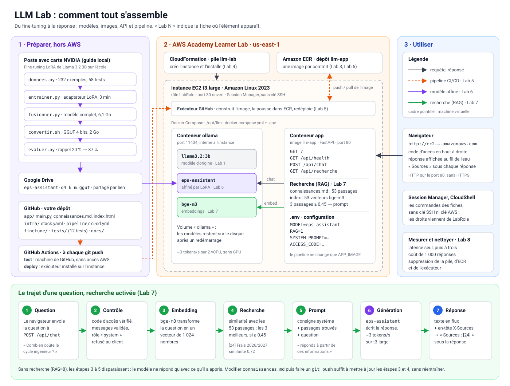

# LLM Lab — kit de TP AWS Academy

Un LLM ouvert servi par Ollama sur une instance EC2, une API FastAPI, une interface web de test,
un modèle CloudFormation et un pipeline GitHub Actions (tests, image dans ECR, déploiement).
En complément, un fine-tuning LoRA et une recherche documentaire (RAG) qui spécialisent l'assistant
sur Polytechnique Sousse.

## Guides

| Guide | Contenu | Où |
| --- | --- | --- |
| [Formation pas à pas sur AWS](docs/formation/README.md) | Labs 0 à 8 dans AWS Academy Learner Lab, dont le modèle spécialisé (Lab 6) et le RAG (Lab 7), puis le guide de l'enseignant. Une page par lab | AWS |
| [Guide local et fine-tuning](docs/guide-local-fine-tuning.md) | Faire tourner l'application sur son poste, spécialiser le modèle par LoRA, puis essayer le RAG | Poste de l'étudiant |
| [Notebook Colab : votre propre assistant](https://colab.research.google.com/github/nevermind78/llm-lab/blob/main/finetune/fine_tuning_colab.ipynb) | Entraîner un modèle LoRA sur vos propres données, le mesurer, l'exporter en GGUF dans Google Drive, pour le Lab 6 | Google Colab, carte graphique gratuite |

La formation existe aussi [en un seul fichier](docs/formation-aws-pas-a-pas.md), pour l'imprimer.

Entraîner votre propre assistant sur vos données, dans Google Colab : 

## Contenu du dépôt

| Chemin | Rôle | Lab |
| --- | --- | --- |
| `app/main.py` | API : `/`, `/api/health`, `/api/chat` (réponse en flux), `/api/recherche` (RAG) | 2, 7 |
| `app/static/index.html` | Interface de discussion, avec les sources des réponses | 2, 7 |
| `app/connaissances.md` | Connaissances de l'assistant : 53 passages sur l'école, un par paragraphe | 7 |
| `app/Dockerfile`, `docker-compose.yml` | Image de l'API, pile Ollama + API | 2, 3 |
| `tests/` | 12 tests avec un faux serveur de modèle et de faux embeddings | 5 |
| `infra/stack.yaml` | CloudFormation : groupe de sécurité + instance auto-configurée | 4 |
| `pipeline/ci-cd.yml` | Pipeline : tests, image vers ECR, déploiement, vérification. À copier dans `.github/workflows/` au lab 5 | 5 |
| `docker-compose.local.yml`, `.env.exemple` | Travail sur son propre poste | Guide local |
| `finetune/` | Données, entraînement LoRA, fusion, conversion GGUF, création du modèle Ollama, évaluation | 6, 7, guide local |
| `finetune/fine_tuning_colab.ipynb` | Le même entraînement en notebook, pour Google Colab, sur les données de l'étudiant | 6 |
| `docs/` | Guides et schéma d'ensemble | |
