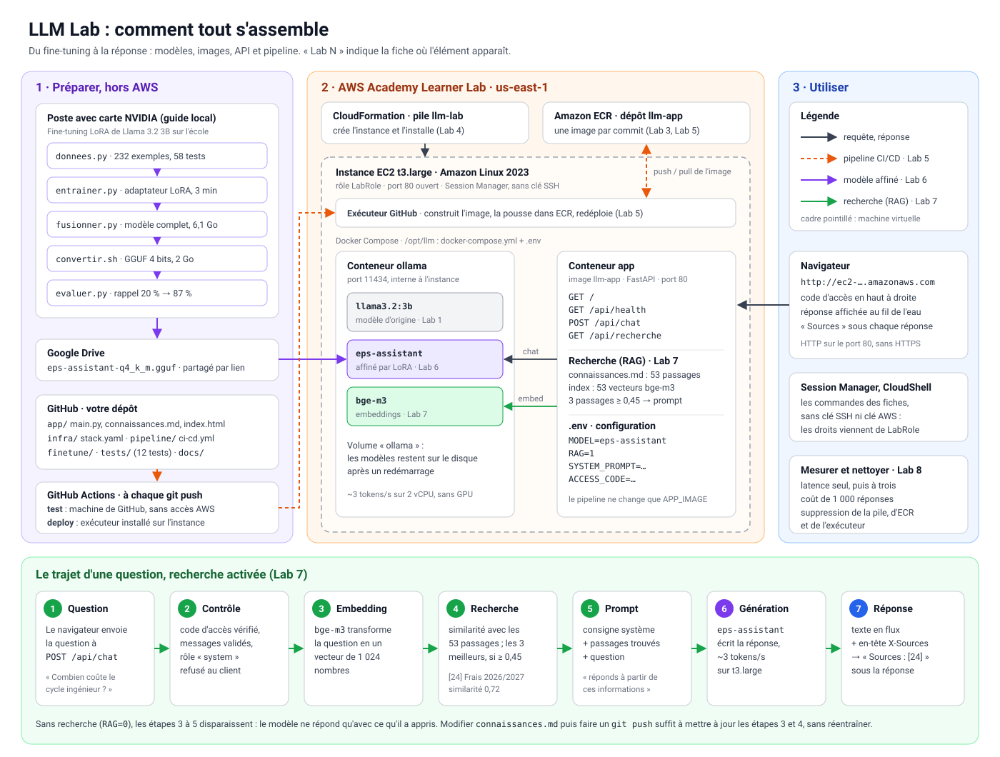

# Déployer un LLM de A à Z sur AWS Academy — formation pas à pas



## Avant de commencer

### Ce que vous allez construire

En neuf labs, vous mettez en ligne un assistant de discussion sur AWS :

1. un modèle de langage ouvert, Llama 3.2 3B, qui tourne sur votre propre machine virtuelle ;
2. une API et une page web pour discuter avec lui depuis un navigateur ;
3. une infrastructure décrite dans un fichier, que vous pouvez détruire et recréer en une commande ;
4. un pipeline qui teste et déploie votre code à chaque `git push` ;
5. un assistant spécialisé sur l'École Polytechnique de Sousse, obtenu par fine-tuning ;
6. une recherche documentaire (RAG), qui fournit au modèle les documents de l'école à chaque question.

| Lab | Titre | Durée | Vous repartez avec |
| --- | --- | --- | --- |
| 0 | Démarrer le Learner Lab et préparer le dépôt | 30 min | Console AWS ouverte, dépôt GitHub prêt |
| 1 | Servir un LLM à la main sur EC2 | 60 min | Un modèle qui répond à `curl` |
| 2 | API et interface web | 60 min | Une page de discussion publique |
| 3 | Image conteneur dans Amazon ECR | 45 min | Une image versionnée dans un registre privé |
| 4 | Tout recréer avec CloudFormation | 60 min | Une pile qui reconstruit le service seule |
| 5 | Pipeline CI/CD | 75 min | Un `git push` qui teste, construit et déploie |
| 6 | Spécialiser l'assistant pour Polytechnique Sousse | 60 min | Un modèle affiné en service, et sa mesure avant/après |
| 7 | Ajouter une recherche documentaire (RAG) | 60 min | Un assistant qui cite ses sources, et des connaissances modifiables sans réentraînement |
| 8 | Mesurer, superviser, nettoyer | 45 min | Trois mesures et un compte propre |

Les labs se suivent dans l'ordre. Chacun se termine par un point de contrôle que l'enseignant vérifie.

### Comment lire ces fiches

- Chaque étape donne **l'action exacte**, puis ***le résultat attendu en italique***. Si vous n'obtenez pas ce résultat, arrêtez-vous et regardez le tableau « Si ça bloque » en fin de lab.
- Les libellés de la console sont en anglais, comme à l'écran.
- Les valeurs à remplacer sont en majuscules. `COMPTE` est votre nom de compte GitHub, `MON-CODE` un code d'accès que vous choisissez (6 caractères au moins, sans espace).
- Les durées et les sorties indiquées sont celles observées pendant le test. Les vôtres seront proches, pas identiques.

### À quoi vous attendre : le modèle est lent, et c'est normal

Le Learner Lab n'offre ni GPU ni machine de plus de 2 processeurs virtuels. Sur l'instance `t3.large` du lab, le modèle écrit environ **3 tokens par seconde**, soit à peu près deux mots par seconde. Une réponse d'une phrase prend 20 à 30 secondes, une réponse de dix lignes plus d'une minute. Ce n'est pas une panne : la réponse s'affiche au fil de l'eau, attendez-la.

Débits mesurés pendant le test, sur la même question :

| Instance | Tarif à la demande | Llama 3.2 3B | Llama 3.2 1B |
| --- | --- | --- | --- |
| `t3.large` (défaut) | 0,083 $ par heure | 2,5 à 3,2 tokens/s | 4,4 tokens/s |
| `m7i.large` | environ 0,10 $ par heure | 3,9 à 4,6 tokens/s | 8,9 tokens/s |

Les tarifs sont cités de mémoire : vérifiez-les sur la page de tarification AWS.

### Les règles du Learner Lab

| Règle | Conséquence dans les labs |
| --- | --- |
| Région `us-east-1` | Tout se fait en `us-east-1` (N. Virginia) |
| Instances de taille « large » au plus, pas de GPU | Instance `t3.large`, modèle sur processeur |
| IAM verrouillé : aucun utilisateur ni rôle à créer | On utilise le rôle fourni `LabRole` et son profil `LabInstanceProfile` |
| Identifiants temporaires, renouvelés à chaque session de 4 heures | Aucune clé AWS dans GitHub : le déploiement part d'un exécuteur installé sur l'instance |
| Instances arrêtées en fin de session, nouvelle adresse au redémarrage | L'adresse du site change à chaque session ; les conteneurs redémarrent seuls |
| Amazon Bedrock refusé (`AccessDenied`) | On déploie soi-même un modèle ouvert |

### Votre budget : 50 $

Le parcours complet devrait consommer moins de 10 $ (estimation). Trois réflexes :

1. À la fin de chaque séance, cliquez **End Lab** : vos instances sont arrêtées, vos ressources conservées.
2. Entre deux séances, seul le disque de l'instance est facturé (environ 2,40 $ par mois pour 30 Gio).
3. À la fin du Lab 8, supprimez tout.

Une `t3.large` laissée allumée en continu consommerait les 50 $ en 25 jours environ.

---

## Lab 0 — Démarrer le Learner Lab et préparer le dépôt

**Durée** : 30 min · **Prérequis** : invitation AWS Academy acceptée, compte GitHub · **Objectif** : ouvrir la console AWS dans la bonne région et posséder votre copie du code.

### Tâche 1 — Ouvrir la console AWS

1. Connectez-vous à AWS Academy et ouvrez le cours **AWS Academy Learner Lab**.
2. Cliquez **Modules**, puis **Launch AWS Academy Learner Lab**. À la première ouverture, acceptez les conditions d'utilisation.
3. Cliquez **Start Lab**, en haut à droite. *Attendu : le point à côté de « AWS » passe du rouge au vert en 1 à 3 minutes.*
4. Notez le budget affiché en haut de la page (« Used $0 of $50 ») et le temps de session restant (4 heures).
5. Cliquez sur **AWS**, à côté du point vert. *Attendu : la console AWS s'ouvre dans un nouvel onglet. Si rien ne s'ouvre, autorisez les fenêtres surgissantes pour ce site.*
6. En haut à droite de la console, vérifiez que la région est **United States (N. Virginia)**, c'est-à-dire `us-east-1`. Sinon, sélectionnez-la dans la liste.

### Tâche 2 — Créer votre dépôt GitHub

1. Ouvrez le dépôt modèle indiqué par l'enseignant.
2. Cliquez **Use this template**, puis **Create a new repository**.
3. Dans **Repository name**, saisissez `llm-lab`. Choisissez **Public**. Cliquez **Create repository**. *Attendu : votre dépôt `COMPTE/llm-lab` contient les dossiers `app`, `infra`, `pipeline` et `tests`.*
4. Cliquez le bouton vert **Code** et copiez l'adresse HTTPS dans un fichier de notes : `https://github.com/COMPTE/llm-lab.git`.

Le dépôt doit être **public** : l'instance le clonera sans mot de passe au Lab 2 et au Lab 4.

### Tâche 3 — Ouvrir CloudShell

1. Dans la console AWS, cliquez l'icône **CloudShell** (un terminal, dans la barre du haut). *Attendu : un terminal s'ouvre en bas de page en moins d'une minute.*
2. Tapez la commande suivante.

```bash
aws sts get-caller-identity
```

*Attendu : un bloc de ce type. Le champ `Arn` contient `voclabs`.*

```json
{
    "UserId": "AROA...:user1234567=Votre_Nom",
    "Account": "123456789012",
    "Arn": "arn:aws:sts::123456789012:assumed-role/voclabs/user1234567=Votre_Nom"
}
```

3. Notez le numéro `Account` à 12 chiffres.

### Point de contrôle

- [ ] La console est en `us-east-1`.
- [ ] Le dépôt `COMPTE/llm-lab` existe et il est public.
- [ ] Le numéro de compte AWS est noté.

**À retenir.** À la fin de la session, le Learner Lab arrête vos instances mais conserve vos ressources. Pour reprendre : **Start Lab**, puis redémarrez l'instance depuis la console EC2.

---

## Lab 1 — Servir un LLM à la main sur EC2

**Durée** : 60 min · **Prérequis** : Lab 0 · **Objectif** : lancer une instance, y installer un serveur de modèle et obtenir une première réponse. Tout est fait à la main, pour comprendre ce que les labs suivants automatiseront.

### Tâche 1 — Lancer l'instance

1. Dans la console AWS, tapez `EC2` dans la barre de recherche et ouvrez le service **EC2**.
2. Cliquez **Launch instance**.
3. **Name** : `llm-manuel`.
4. **Application and OS Images** : laissez **Amazon Linux 2023 AMI** et l'architecture **64-bit (x86)**.
5. **Instance type** : choisissez `t3.large` (2 vCPU, 8 Gio de mémoire).
6. **Key pair (login)** : choisissez **Proceed without a key pair**.
7. **Network settings** : cochez **Allow HTTP traffic from the internet** et décochez **Allow SSH traffic from**.
8. **Configure storage** : remplacez 8 par `30` GiB et gardez **gp3**.
9. Dépliez **Advanced details**. Dans **IAM instance profile**, choisissez `LabInstanceProfile`.
10. Cliquez **Launch instance**, puis **View all instances**. *Attendu : `llm-manuel` passe à l'état **Running** en 20 à 60 secondes.*

### Tâche 2 — Se connecter sans clé SSH

1. Cochez l'instance `llm-manuel`, cliquez **Connect**, ouvrez l'onglet **Session Manager**, puis cliquez **Connect**. Si le bouton est grisé, patientez 2 minutes et rechargez la page : l'agent de l'instance n'a pas encore démarré.
2. Dans le terminal qui s'ouvre, passez administrateur.

```bash
sudo -i
```

*Attendu : l'invite devient `[root@ip-... ~]#`.*

### Tâche 3 — Installer Docker et le serveur de modèle

1. Installez Docker et Git, puis démarrez Docker.

```bash
dnf install -y docker git
systemctl enable --now docker
```

*Attendu : la première commande se termine par `Complete!`.*

2. Lancez Ollama, le logiciel qui fait tourner le modèle.

```bash
docker run -d --name ollama -p 127.0.0.1:11434:11434 -v ollama:/root/.ollama ollama/ollama
```

*Attendu : Docker télécharge une image d'environ 5 Go, puis affiche un long identifiant. Comptez 2 à 3 minutes.*

3. Vérifiez que le conteneur tourne.

```bash
docker ps
```

*Attendu : une ligne `ollama` avec l'état `Up`.*

### Tâche 4 — Télécharger le modèle et l'interroger

1. Téléchargez le modèle.

```bash
docker exec ollama ollama pull llama3.2:3b
```

*Attendu : une barre de progression pour environ 2 Go, puis `success`. Le téléchargement a pris 20 secondes pendant le test.*

2. Posez une première question.

```bash
time curl -s localhost:11434/api/chat -d '{
  "model": "llama3.2:3b", "stream": false,
  "messages": [{"role": "user", "content": "Explique le cloud en une phrase."}]
}'
```

*Attendu : après 20 à 30 secondes sans rien à l'écran, un bloc JSON dont le champ `message.content` contient une phrase en français. Notez la durée `real`.*

3. Dans ce même JSON, relevez deux nombres : `eval_count` (le nombre de tokens générés) et `eval_duration` (la durée en nanosecondes). Calculez le débit : `eval_count / (eval_duration / 1 000 000 000)`. *Attendu : environ 3 tokens par seconde.*

### Tâche 5 — Observer la machine

1. Lancez les trois commandes suivantes.

```bash
docker exec ollama ollama ps
free -h
docker stats --no-stream
```

*Attendu : `ollama ps` indique le modèle `llama3.2:3b`, une taille de 2,6 Go et `100% CPU`. `free -h` montre environ 4,5 Gio dans la colonne `available`.*

2. Relancez la requête de la tâche 4 et comparez la durée. Le premier appel charge le modèle en mémoire (6,5 secondes pendant le test), les suivants non. Après 5 minutes sans requête, Ollama décharge le modèle.

### Point de contrôle

- [ ] L'instance a le profil `LabInstanceProfile` et aucun port 22 ouvert.
- [ ] `curl` renvoie une réponse du modèle.
- [ ] Vous savez dire combien de mémoire le modèle occupe et quel est son débit en tokens par seconde.

### Questions de synthèse

1. Pourquoi le port 11434 est-il lié à `127.0.0.1` et non ouvert sur Internet ?
2. Qu'est-ce qui a permis la connexion sans mot de passe ni clé ?
3. Que se passerait-il avec une instance `t3.medium` (4 Gio de mémoire) ?

### Si ça bloque

| Symptôme | Remède |
| --- | --- |
| Onglet Session Manager : « not connected » | Vérifier le profil IAM dans **Actions** > **Security** > **Modify IAM role**, puis redémarrer l'instance |
| Lancement refusé pour le type d'instance | Choisir une taille « large » au plus |
| `pull` très lent ou interrompu | Relancer la même commande : le téléchargement reprend |
| `curl` ne rend rien pendant 30 secondes | C'est normal : avec `"stream": false`, la réponse arrive d'un bloc à la fin |

Laissez l'instance allumée pour le Lab 2.

---

## Lab 2 — API et interface web

**Durée** : 60 min · **Prérequis** : Lab 1, instance `llm-manuel` allumée · **Objectif** : placer une API devant le modèle et discuter avec lui depuis un navigateur.

### Tâche 1 — Installer Docker Compose et récupérer le code

Dans le terminal Session Manager, en `root` (retapez `sudo -i` si vous venez de vous reconnecter) :

1. Installez Docker Compose.

```bash
mkdir -p /usr/libexec/docker/cli-plugins
curl -fsSL https://github.com/docker/compose/releases/latest/download/docker-compose-linux-x86_64 \
  -o /usr/libexec/docker/cli-plugins/docker-compose
chmod +x /usr/libexec/docker/cli-plugins/docker-compose
docker compose version
```

*Attendu : `Docker Compose version v5.x.x` (v5.7.1 pendant le test).*

2. Supprimez le conteneur du Lab 1 et récupérez votre code. Remplacez `COMPTE`.

```bash
docker rm -f ollama
git clone https://github.com/COMPTE/llm-lab.git /opt/llm
cd /opt/llm && ls
```

*Attendu : `ls` montre `README.md`, `app`, `docker-compose.yml`, `infra`, `pipeline`, `tests`.*

### Tâche 2 — Configurer et démarrer la pile

1. Écrivez le fichier de configuration. Remplacez `MON-CODE` par votre code d'accès.

```bash
cat > /opt/llm/.env <<EOF
MODEL=llama3.2:3b
ACCESS_CODE=MON-CODE
APP_IMAGE=llm-app:local
EOF
```

2. Construisez l'image de l'API. *Attendu : la dernière ligne contient `naming to docker.io/library/llm-app:local done` ; comptez 15 secondes.*

```bash
cd /opt/llm
docker build -t llm-app:local /opt/llm/app
```

3. Vérifiez que l'image existe avant d'aller plus loin. *Attendu : une ligne `llm-app   local`, d'environ 170 Mo. Si la liste est vide, la construction a échoué : relisez le message d'erreur de l'étape 2 et recommencez-la.*

```bash
docker images llm-app
```

4. Démarrez les deux conteneurs. *Attendu : `Container llm-ollama-1 Started` et `Container llm-app-1 Started`.*

```bash
cd /opt/llm
docker compose up -d
```

5. Téléchargez le modèle dans le volume de la pile. Il est téléchargé une seconde fois, parce que ce volume n'est pas celui du Lab 1. *Attendu : `success`.*

```bash
docker compose exec ollama ollama pull llama3.2:3b
```

Si la commande répond `could not connect to ollama server`, Ollama n'a pas fini de démarrer : attendez 5 secondes et relancez-la.

6. Vérifiez l'état des services et de l'API.

```bash
docker compose ps
curl -s localhost/api/health
```

*Attendu : deux services `ollama` et `app` à l'état `running`, puis :*

```json
{"ok":true,"version":"dev","modele":"llama3.2:3b","modele_pret":true}
```

**Pourquoi `docker build` puis `docker compose up` ?** La commande habituelle `docker compose up -d --build` échoue sur Amazon Linux 2023 avec le message `compose build requires buildx 0.17.0 or later` : le Docker fourni par Amazon est trop ancien pour la construction intégrée à Compose. On construit donc l'image séparément. Le même message apparaît si vous lancez `docker compose up -d` alors que l'image `llm-app:local` n'existe pas : Compose tente alors de la construire lui-même.

### Tâche 3 — Tester depuis le navigateur

1. Dans la console EC2, cochez l'instance `llm-manuel` et copiez la valeur **Public IPv4 DNS**, de la forme `ec2-54-237-228-253.compute-1.amazonaws.com`.
2. Dans un nouvel onglet, ouvrez `http://ADRESSE-COPIÉE`. Tapez bien `http://` : le site n'a pas de certificat, et `https://` ne répondra pas.
3. *Attendu : une page « LLM Lab » dont l'en-tête affiche « version dev · llama3.2:3b · modèle prêt ».*
4. Saisissez votre code d'accès en haut à droite, posez une question courte, envoyez. *Attendu : après quelques secondes, la réponse s'écrit progressivement ; à la fin, la durée et le débit en caractères par seconde s'affichent dessous.*
5. Videz le champ du code et renvoyez une question. *Attendu : « Échec : code d'accès invalide ».*

Pour convertir le débit affiché en tokens par seconde, divisez-le par 4,4 : en français, un token de ce modèle vaut environ 4,4 caractères.

### Tâche 4 — Lire le code

Ouvrez `app/main.py` sur GitHub et répondez :

1. Quelles sont les trois routes de l'API ?
2. À quelle ligne le prompt système est-il ajouté ? Pourquoi le navigateur n'a-t-il pas le droit d'envoyer un message de rôle `system` ?
3. Quelles limites protègent le service contre une requête abusive ?

### Tâche 5 — Essayer un autre modèle (optionnel)

| Étiquette Ollama | Taille | Remarque |
| --- | --- | --- |
| `llama3.2:1b` | environ 1,3 Go | Presque deux fois plus rapide (4,4 tokens/s mesurés), qualité inférieure |
| `llama3.2:3b` | environ 2 Go | Valeur par défaut, environ 3 tokens/s |
| `gemma3:4b` | environ 3,3 Go | 2,2 tokens/s, un peu plus lent ; 2,9 Go en mémoire |
| `qwen2.5:7b` | environ 4,7 Go | 1,3 tokens/s, deux fois plus lent ; 5,1 Go en mémoire, cela tient sur une `t3.large` |

```bash
cd /opt/llm
docker compose exec ollama ollama pull llama3.2:1b
sed -i 's|^MODEL=.*|MODEL=llama3.2:1b|' .env && docker compose up -d
```

Posez la même question aux deux modèles et comparez la qualité et le débit. Les débits du tableau sont ceux d'une `t3.large` ; chaque téléchargement prend moins d'une minute. Remettez ensuite `MODEL=llama3.2:3b` de la même façon.

### Point de contrôle

- [ ] L'interface répond à une question depuis votre navigateur.
- [ ] Une requête sans code est refusée.
- [ ] Vous avez noté un débit en caractères par seconde.

### Si ça bloque

| Symptôme | Remède |
| --- | --- |
| `compose build requires buildx 0.17.0 or later` | L'image `llm-app:local` n'existe pas (construction sautée ou échouée), ou vous avez tapé `--build`. Lancez `docker build -t llm-app:local /opt/llm/app`, vérifiez avec `docker images llm-app`, puis `docker compose up -d` |
| `unable to prepare context: path "app" not found` | Vous n'êtes pas dans `/opt/llm` : utilisez le chemin complet `/opt/llm/app` |
| `no configuration file provided: not found` | Vous n'êtes pas dans `/opt/llm` : tapez `cd /opt/llm` et relancez la commande |
| La page ne charge pas | Vérifier `http://` et la règle du groupe de sécurité (port 80, source `0.0.0.0/0`) |
| En-tête : « modèle absent » | Relancer `docker compose exec ollama ollama pull llama3.2:3b` |
| Réponse « erreur du serveur de modèle » | `docker compose logs ollama --tail 30` ; modèle absent, ou mémoire insuffisante si le modèle est trop gros |

---

## Lab 3 — Image conteneur dans Amazon ECR

**Durée** : 45 min · **Prérequis** : Lab 2 · **Objectif** : publier l'image de l'API dans un registre privé, avec une étiquette de version, et faire tourner le service depuis cette image.

### Tâche 1 — Créer le dépôt d'images

Dans le terminal de l'instance, en `root` :

```bash
export AWS_DEFAULT_REGION=us-east-1
aws ecr create-repository --repository-name llm-app
```

*Attendu : un JSON contenant `repositoryUri`, de la forme `123456789012.dkr.ecr.us-east-1.amazonaws.com/llm-app`.*

### Tâche 2 — S'authentifier, construire, pousser

1. Connectez Docker au registre.

```bash
COMPTE=$(aws sts get-caller-identity --query Account --output text)
REGISTRE=$COMPTE.dkr.ecr.us-east-1.amazonaws.com
aws ecr get-login-password | docker login --username AWS --password-stdin $REGISTRE
```

*Attendu : `Login Succeeded`.*

2. Construisez l'image avec l'étiquette `v1` et poussez-la.

```bash
docker build -t $REGISTRE/llm-app:v1 --build-arg APP_VERSION=v1 /opt/llm/app
docker push $REGISTRE/llm-app:v1
```

*Attendu : chaque couche affiche `Pushed`, puis une ligne `v1: digest: sha256:... size: ...`.*

Les variables `COMPTE` et `REGISTRE` disparaissent si vous fermez le terminal : en cas de reconnexion, retapez les deux premières lignes de l'étape 1.

### Tâche 3 — Servir depuis l'image du registre

```bash
cd /opt/llm
sed -i "s|^APP_IMAGE=.*|APP_IMAGE=$REGISTRE/llm-app:v1|" .env
docker compose up -d --no-build
curl -s localhost/api/health
```

*Attendu : `{"ok":true,"version":"v1","modele":"llama3.2:3b","modele_pret":true}`. Rechargez la page web : l'en-tête affiche « version v1 ».*

### Tâche 4 — Inspecter dans la console

1. Console AWS > **Elastic Container Registry** > **Repositories** > `llm-app`.
2. Relevez l'étiquette, la taille de l'image et sa date. *Attendu : une image `v1` d'environ 60 Mo.*

### Point de contrôle

- [ ] Le dépôt ECR `llm-app` contient l'image `v1`.
- [ ] `/api/health` renvoie la version `v1`.

### Questions de synthèse

1. Aucune clé AWS n'a été saisie : d'où viennent les droits de pousser dans ECR ? Indice : `aws sts get-caller-identity` sur l'instance.
2. Pourquoi une étiquette `v1` plutôt que `latest` ?
3. Le modèle de 2 Go n'est pas dans l'image. Où est-il, et quel est l'avantage ?

### Si ça bloque

| Symptôme | Remède |
| --- | --- |
| `AccessDenied` sur `ecr:CreateRepository` | Prévenir l'enseignant |
| `no basic auth credentials` au `push` | Relancer la commande `docker login` : le jeton dure 12 heures |
| `sed` ne change rien, la version reste `dev` | La variable `REGISTRE` est vide : retapez l'étape 1 de la tâche 2 |

---

## Lab 4 — Tout recréer avec CloudFormation

**Durée** : 60 min · **Prérequis** : Lab 3 · **Objectif** : remplacer les manipulations des labs 1 et 2 par un fichier, `infra/stack.yaml`, qui reconstruit le service sans intervention.

### Tâche 1 — Détruire ce qui a été fait à la main

1. Console EC2 > cochez `llm-manuel` > **Instance state** > **Terminate (delete) instance** > confirmez. *Attendu : état **Terminated** en moins d'une minute. Le dépôt ECR n'est pas touché.*

### Tâche 2 — Déployer la pile

1. Ouvrez **CloudShell** et clonez votre dépôt. Remplacez `COMPTE`.

```bash
git clone https://github.com/COMPTE/llm-lab.git && cd llm-lab
```

2. Déployez la pile. Remplacez `COMPTE` et `MON-CODE`.

```bash
aws cloudformation deploy --stack-name llm-lab \
  --template-file infra/stack.yaml \
  --parameter-overrides AccessCode=MON-CODE \
      RepoUrl=https://github.com/COMPTE/llm-lab.git
```

*Attendu après 40 secondes environ : `Successfully created/updated stack - llm-lab`.*

3. Affichez l'adresse du service.

```bash
aws cloudformation describe-stacks --stack-name llm-lab \
  --query "Stacks[0].Outputs" --output table
```

*Attendu : deux lignes, `InstanceId` et `Url`.*

### Tâche 3 — Suivre l'installation automatique

La pile est « créée » dès que l'instance démarre, mais le script de démarrage travaille encore : Docker, clonage du dépôt, construction de l'image, téléchargement d'Ollama et du modèle. Pendant le test, le service était prêt **4 minutes 30** après la création de la pile.

1. Console EC2 > instance `llm-lab` > **Connect** > **Session Manager** > **Connect**.
2. Suivez le journal.

```bash
sudo tail -f /var/log/llm-lab-setup.log
```

*Attendu : le journal défile, puis se termine par les lignes `verifying sha256 digest`, `writing manifest` et `success`. Quittez avec Ctrl+C.*

3. Ouvrez l'`Url` de la tâche 2 dans le navigateur et posez une question. *Attendu : même comportement qu'au Lab 2, sans avoir tapé une seule commande d'installation.*

### Tâche 4 — Lire le modèle et la console

1. Console **CloudFormation** > pile `llm-lab` > onglets **Events**, **Resources**, **Parameters**, **Outputs**.
2. Ouvrez `infra/stack.yaml` sur GitHub et retrouvez, pour chaque geste du Lab 1, la ligne qui le remplace.

| Geste du Lab 1 | Ligne du modèle |
| --- | --- |
| Instance type `t3.large` | `InstanceType: !Ref InstanceType` |
| Allow HTTP traffic | `WebSecurityGroup`, port 80 |
| 30 GiB gp3 | `BlockDeviceMappings` |
| IAM instance profile | `IamInstanceProfile: LabInstanceProfile` |
| Commandes tapées en `root` | `UserData` |

3. Dans `UserData`, repérez la ligne `until docker compose exec -T ollama ollama list; do sleep 2; done`. À quoi sert-elle ? Indice : relisez la remarque de l'étape 5, tâche 2 du Lab 2.

### Tâche 5 — Changer un paramètre (optionnel)

On passe l'instance sur une `m7i.large`, environ 1,5 fois plus rapide, en modifiant un seul paramètre de la pile.

1. Dans CloudShell, depuis le dossier `llm-lab` de la tâche 2 :

```bash
aws cloudformation deploy --stack-name llm-lab --template-file infra/stack.yaml \
  --parameter-overrides InstanceType=m7i.large
```

*Attendu, après 1 à 2 minutes : `Successfully created/updated stack - llm-lab`. Les paramètres que vous ne citez pas, comme le code d'accès et l'adresse du dépôt, gardent leur valeur.*

2. Console **CloudFormation** > pile `llm-lab` > onglet **Events**. *Attendu : `LlmInstance` passe à `UPDATE_IN_PROGRESS`, puis `UPDATE_COMPLETE`. Pour changer le type, CloudFormation arrête l'instance, la modifie et la redémarre ; le détail n'apparaît pas dans les événements.*
3. Relisez la sortie de la pile.

```bash
aws cloudformation describe-stacks --stack-name llm-lab \
  --query "Stacks[0].Outputs" --output table
```

*Attendu : une nouvelle `Url`. L'adresse publique change à chaque redémarrage ; ici, la sortie est à jour, parce que c'est CloudFormation qui a redémarré l'instance.*

4. Ouvrez la nouvelle adresse. *Attendu : l'interface répond environ 2 minutes après le lancement de la commande, sans aucune intervention sur l'instance : les conteneurs redémarrent seuls.*
5. Revenez à une `t3.large` avec la même commande et `InstanceType=t3.large` : les durées des fiches suivantes sont données pour ce type, et une `m7i.large` coûte environ 20 % de plus par heure.

### Point de contrôle

- [ ] La pile `llm-lab` est à l'état `CREATE_COMPLETE` ou `UPDATE_COMPLETE`.
- [ ] L'interface répond à l'adresse donnée par la sortie `Url`.
- [ ] L'instance `llm-manuel` est supprimée.

### Questions de synthèse

1. Le modèle ne crée aucun rôle IAM. Pourquoi, dans le Learner Lab ?
2. Le code d'accès est déclaré `NoEcho`. Que cache cette option, et que ne cache-t-elle pas ? Indice : `sudo cat /opt/llm/.env` sur l'instance.
3. Citez deux avantages d'une pile par rapport aux gestes du Lab 1.

### Si ça bloque

| Symptôme | Remède |
| --- | --- |
| Pile en `ROLLBACK_COMPLETE` | Lire la première ligne rouge de l'onglet **Events** ; supprimer la pile avant de relancer |
| La page répond mais l'en-tête dit « modèle absent » après 10 minutes | Lire la fin de `/var/log/llm-lab-setup.log` ; relancer à la main `cd /opt/llm && sudo docker compose exec ollama ollama pull llama3.2:3b` |
| La page ne répond pas après 10 minutes | Lire `/var/log/llm-lab-setup.log` : une erreur de clonage signale un dépôt privé ou une URL fausse |
| `Parameter validation failed` sur `AccessCode` | Le code doit compter au moins 6 caractères |

---

## Lab 5 — Pipeline CI/CD

**Durée** : 75 min · **Prérequis** : Lab 4, pile `llm-lab` en service · **Objectif** : chaque `git push` sur `main` lance les tests, construit une image dans ECR, la déploie et vérifie la version en service.

Le pipeline a deux étages. Les tests tournent sur une machine de GitHub, sans aucun accès à AWS. Le déploiement tourne sur un exécuteur (« runner ») installé sur votre instance : il hérite des droits du rôle de l'instance, donc aucune clé AWS n'est stockée dans GitHub.

### Tâche 1 — Installer l'exécuteur GitHub sur l'instance

1. GitHub > votre dépôt `llm-lab` > **Settings** > **Actions** > **Runners** > **New self-hosted runner**. Choisissez **Linux** et **x64**. Gardez la page ouverte.
2. Connectez-vous à l'instance `llm-lab` par Session Manager, puis prenez l'identité `ec2-user`.

```bash
sudo -iu ec2-user
```

*Attendu : l'invite devient `[ec2-user@ip-... ~]$`.*

3. Copiez-collez, une par une, les commandes du bloc **Download** de la page GitHub. La commande de vérification qui contient `shasum -a 256 -c` répond `shasum: command not found` : ce programme n'existe pas sur Amazon Linux 2023. Ignorez cette erreur, ou remplacez `shasum -a 256 -c` par `sha256sum -c` pour obtenir `OK`.
4. Copiez-collez la commande `./config.sh --url ... --token ...` du bloc **Configure**. Validez chaque question par Entrée pour garder les valeurs par défaut. *Attendu : `Connected to GitHub`, `Runner successfully added` et `Settings Saved`.*
5. Installez l'exécuteur comme service, pour qu'il redémarre avec l'instance.

```bash
sudo ./svc.sh install ec2-user
sudo ./svc.sh start
```

*Attendu : une ligne `Active: active (running)`. Sur la page **Runners** de GitHub, l'exécuteur apparaît avec l'état **Idle**.*

N'exécutez pas la commande `./run.sh` proposée par GitHub : le service la remplace.

### Tâche 2 — Activer le pipeline

1. GitHub > ouvrez `pipeline/ci-cd.yml` > bouton **Copy raw file**.
2. Revenez à la racine du dépôt > **Add file** > **Create new file**. Dans le nom, tapez `.github/workflows/ci-cd.yml` : chaque `/` crée un dossier. Collez le contenu.
3. Cliquez **Commit changes...**, puis **Commit changes**, directement sur `main`.
4. Onglet **Actions** : ouvrez l'exécution en cours. *Attendu : la tâche `test` passe au vert en 25 à 35 secondes, puis `deploy` en 15 secondes environ. Dépliez sa dernière étape : elle affiche « Version abc1234 en service », où `abc1234` est l'identifiant de votre commit.*
5. Rechargez l'interface web. *Attendu : l'en-tête affiche la même version à 7 caractères que le pipeline.*

### Tâche 3 — Livrer une modification

1. GitHub > `app/static/index.html` > crayon **Edit this file**.
2. Remplacez `<h1>LLM Lab</h1>` par `<h1>LLM Lab de PRÉNOM</h1>`, puis **Commit changes**.
3. Suivez l'onglet **Actions**, puis rechargez la page web. *Attendu, environ une minute après le commit : le nouveau titre et un nouveau numéro de version, sans aucune commande sur l'instance.*
4. Console ECR > `llm-app`. *Attendu : une image par commit déployé, étiquetée par son identifiant, en plus de `v1`.*

### Tâche 4 — Voir le pipeline bloquer une erreur

1. Notez la version affichée par l'interface web.
2. Dans `app/main.py`, remplacez `MAX_MESSAGES, MAX_CARACTERES = 20, 4000` par `MAX_MESSAGES, MAX_CARACTERES = 20, 400000`, puis **Commit changes**.
3. Onglet **Actions**. *Attendu : `test` échoue (croix rouge) et `deploy` est ignoré (icône grise). Dans le journal de `test` :*

```
FAILED tests/test_api.py::test_message_trop_long - AssertionError: assert 200 == 422
1 failed, 11 passed
```

4. Rechargez la page web. *Attendu : la version en service n'a pas changé.*
5. Remettez `4000`, validez, et vérifiez que le pipeline repasse au vert et déploie une nouvelle version.

### Tâche 5 — Revenir à une version précédente

1. Onglet **Actions** > ouvrez l'exécution verte de la tâche 2 > **Re-run all jobs** > **Re-run jobs**.
2. Rechargez la page web. *Attendu : l'ancien titre « LLM Lab » et l'ancien numéro de version sont de retour.*
3. Relancez de la même façon l'exécution la plus récente pour revenir à la dernière version. *Attendu : le titre « LLM Lab de PRÉNOM » revient.*

### Point de contrôle

- [ ] L'exécuteur est **Idle** dans GitHub.
- [ ] Un commit sur `main` a changé la version affichée par l'interface.
- [ ] Un commit qui casse un test n'a pas été déployé.

### Questions de synthèse

1. Quelle étape du pipeline est de l'intégration continue, laquelle du déploiement continu ?
2. Pourquoi ne pas avoir collé les identifiants AWS du Learner Lab dans les secrets GitHub ?
3. La dernière étape interroge `/api/health`. Que se passerait-il sans elle si le conteneur ne démarrait pas ?

### Si ça bloque

| Symptôme | Remède |
| --- | --- |
| `deploy` reste en attente (« Waiting for a runner ») | Instance arrêtée, ou service absent : `sudo ./svc.sh status` dans le dossier `actions-runner` |
| `config.sh` : jeton expiré | Le jeton dure 1 heure : recharger la page **New self-hosted runner** |
| `Must not run with sudo` | Vous êtes `root` : tapez `exit`, puis `sudo -iu ec2-user` |
| `permission denied` sur le socket Docker | L'exécuteur doit être installé pour `ec2-user` : `sudo ./svc.sh uninstall`, puis reprendre l'étape 5 |
| `RepositoryNotFoundException` | Le dépôt ECR `llm-app` du Lab 3 a été supprimé : le recréer |

---

## Lab 6 — Spécialiser l'assistant pour Polytechnique Sousse

**Durée** : 45 à 60 min · **Prérequis** : Lab 5, pile `llm-lab` en service · **Objectif** : remplacer le modèle généraliste par un modèle affiné sur les informations de l'École Polytechnique de Sousse, le déployer sur votre instance et mesurer le gain.

### Le principe

Un modèle généraliste ne connaît pas votre école : interrogé sur son adresse ou ses frais, il invente. Le **fine-tuning** lui fait apprendre ces informations à partir d'exemples question-réponse. La méthode utilisée, **LoRA**, n'entraîne que 0,75 % des paramètres du modèle.

L'entraînement demande une carte graphique, que le Learner Lab n'offre pas. Il a donc été fait en dehors d'AWS, et vous partez du résultat : un fichier `eps-assistant-q4_k_m.gguf` de 2 Go, mis à disposition par l'enseignant sur Google Drive. Pour l'entraîner vous-même sur votre poste, suivez la partie B du « Guide local » (`docs/guide-local-fine-tuning.md` dans votre dépôt).

[](https://colab.research.google.com/github/nevermind78/llm-lab/blob/main/finetune/fine_tuning_colab.ipynb)

**Votre propre assistant, sur le sujet de votre choix** : ouvrez le notebook [Google Colab](https://colab.research.google.com/github/nevermind78/llm-lab/blob/main/finetune/fine_tuning_colab.ipynb) (`finetune/fine_tuning_colab.ipynb`). Il entraîne le modèle sur la carte graphique gratuite de Colab, dépose le fichier GGUF dans votre Google Drive, puis affiche les commandes de ce lab adaptées à votre modèle : votre identifiant Drive à la tâche 2, votre nom de modèle à la tâche 3, votre prompt système à la tâche 4.

Mesures faites pendant la préparation, sur 58 questions jamais vues à l'entraînement :

| Modèle | Informations retrouvées | Réponses correctes à plus de 80 % |
| --- | --- | --- |
| `llama3.2:3b` (modèle actuel) | 20 % | 0 sur 58 |
| `eps-assistant` (modèle affiné) | 87 % | 49 sur 58 |

### Tâche 1 — Interroger le modèle actuel

1. Ouvrez votre interface web (adresse **Public IPv4 DNS** de l'instance `llm-lab`, en `http://`) et saisissez votre code d'accès.
2. Posez la question : « Quelle est l'adresse de l'École Polytechnique de Sousse ? » *Attendu : une adresse inventée. Pendant la préparation, le modèle a répondu « Rue de la République, 8018 Sousse », qui est fausse.*
3. Notez la réponse : vous la comparerez à la tâche 4.

### Tâche 2 — Télécharger le modèle affiné sur l'instance

1. Console EC2 > instance `llm-lab` > **Connect** > **Session Manager** > **Connect**, puis passez administrateur et placez-vous dans le dossier de l'application.

```bash
sudo -i
cd /opt/llm
ls finetune
```

*Attendu : `ls` liste notamment `creer_modele.sh`, `env-eps.exemple`, `evaluer.py` et `test.jsonl`. Si vous lisez `No such file or directory`, votre dépôt est antérieur à l'ajout du fine-tuning : voyez « Si ça bloque ».*

2. Téléchargez le fichier depuis Google Drive. La variable `ID` est l'identifiant du fichier : la partie du lien de partage située entre `/d/` et `/view`.

```bash
ID=1kQEEPJPb_2AB_degK7UmEkbb0wXiBhPh
curl -L -o /tmp/eps-assistant.gguf \
  "https://drive.usercontent.google.com/download?id=$ID&export=download&confirm=t"
```

*Attendu : une barre de progression, puis le retour à l'invite. Pendant le test, le téléchargement a pris 25 secondes.*

3. Vérifiez le fichier.

```bash
ls -lh /tmp/eps-assistant.gguf
head -c 4 /tmp/eps-assistant.gguf; echo
```

*Attendu : une taille de `1.9G`, puis le mot `GGUF`. Si vous lisez une petite taille et `<!do` ou `<htm`, vous avez reçu une page web au lieu du modèle : voyez « Si ça bloque ».*

### Tâche 3 — Créer le modèle dans Ollama

1. Copiez le fichier et le script de création dans le conteneur Ollama, puis lancez le script.

```bash
docker compose cp /tmp/eps-assistant.gguf ollama:/tmp/eps-assistant.gguf
docker compose cp finetune/creer_modele.sh ollama:/tmp/creer_modele.sh
docker compose exec ollama sh /tmp/creer_modele.sh
```

*Attendu, après 30 secondes environ : deux lignes `Copied ...`, puis `success` et la liste des modèles :*

```
NAME                    ID              SIZE      MODIFIED
eps-assistant:latest    450ac550a2b6    2.0 GB    Less than a second ago
llama3.2:3b             a80c4f17acd5    2.0 GB    ...
```

2. Supprimez la copie devenue inutile, puis vérifiez l'espace disque.

```bash
rm /tmp/eps-assistant.gguf
df -h /
```

*Attendu : une ligne `/dev/nvme0n1p1   30G   12G   19G  40% /` ou proche : il reste largement de la place.*

Le script `creer_modele.sh` reprend le gabarit de prompt de `llama3.2:3b`. C'est ce même gabarit qui a servi pendant l'entraînement : sans lui, le modèle affiné répondrait mal.

### Tâche 4 — Basculer l'application sur le modèle affiné

1. Changez le modèle dans le fichier de configuration et ajoutez le prompt système de l'assistant de l'école, sans toucher au code d'accès ni à l'image.

```bash
sed -i 's|^MODEL=.*|MODEL=eps-assistant|' .env
grep -q '^SYSTEM_PROMPT=' .env || grep '^SYSTEM_PROMPT=' finetune/env-eps.exemple >> .env
cat .env
```

*Attendu : quatre lignes : `MODEL=eps-assistant`, votre `ACCESS_CODE`, l'`APP_IMAGE` déployée par le pipeline, et `SYSTEM_PROMPT="Tu es l'assistant de Polytechnique Sousse ..."`.*

2. Redémarrez l'API avec cette configuration et vérifiez-la.

```bash
docker compose up -d --no-build
curl -s localhost/api/health
```

*Attendu : `Container llm-app-1 Started`, puis `{"ok":true,"version":"...","modele":"eps-assistant","modele_pret":true}`. La version n'a pas changé : l'image est la même, seule la configuration a changé.*

3. Rechargez l'interface web et posez ces questions. *Attendu : l'en-tête affiche « eps-assistant · modèle prêt », et les réponses ci-dessous. Comptez environ 25 secondes par réponse : c'est ce qui a été mesuré pendant le test.*

| Question | Réponse attendue |
| --- | --- |
| Quelle est l'adresse de l'École Polytechnique de Sousse ? | Route Ceinture Sahloul, Entrée Kalaa Sghira, 4021 Sousse, Tunisie |
| Combien coûte le cycle ingénieur pour un étudiant tunisien ? | 7 849 DT par an en 2026/2027, en trois tranches de 3 250, 2 700 et 1 899 DT |
| Quels sont les parcours en génie informatique ? | Génie Logiciel, Data Science & IA, Business Intelligence, Cybersécurité, Internet of Things |
| Explique le cloud en une phrase. | Une réponse générale correcte : le modèle n'a pas oublié le reste |

### Tâche 5 — Mesurer le gain

Le script `evaluer.py` pose les mêmes questions de test aux deux modèles et calcule le **rappel** : la part des mots importants de la réponse de référence retrouvés dans la réponse du modèle. On le lance dans le conteneur de l'API, qui contient déjà Python.

```bash
docker compose run --rm -v /opt/llm/finetune:/f -w /f app \
  python evaluer.py llama3.2:3b eps-assistant --url http://ollama:11434 --n 5
```

*Attendu, après 4 minutes environ : deux lignes de ce type. Le rappel du modèle de base varie selon les questions tirées ; le modèle affiné doit le dépasser nettement. Sortie obtenue pendant le test :*

```
llama3.2:3b                  rappel moyen  41.8 % · réponses à plus de 80 % : 0/5 · 2.6 tokens/s · 165 s
eps-assistant                rappel moyen 100.0 % · réponses à plus de 80 % : 5/5 · 2.8 tokens/s · 71 s
Détail des réponses dans evaluation.json
```

Notez les deux rappels. Le détail des réponses est dans `/opt/llm/finetune/evaluation.json` : lisez-le avec `cat finetune/evaluation.json`.

Pendant l'évaluation, les deux modèles sont chargés en même temps : la mémoire utilisée a culminé à 5,6 Go sur 7,8 pendant le test. Vous pouvez le vérifier pendant que le script tourne, dans un second onglet Session Manager, avec `free -h`.

### Tâche 6 — Chercher les limites

Le modèle affiné n'est pas fiable à 100 %. Posez-lui ces questions dans l'interface : elles l'ont mis en défaut pendant la préparation.

| Question | Ce qui s'est passé pendant la préparation |
| --- | --- |
| Est-ce qu'il y a un internat à l'EPS ? | Il a affirmé qu'un foyer existe, alors qu'il devait dire qu'il ne sait pas |
| Quelles sont les dates limites des tranches ? | Il a inventé des dates, sept lors d'un essai et quatre lors d'un autre, au lieu des deux vraies (31 décembre et 31 mars) |
| J'ai une licence, puis-je intégrer le cycle ingénieur ? | Il a répondu sur le Master 1, une question voisine |

### Tâche 7 — Vérifier que le pipeline garde le modèle

1. Sur GitHub, modifiez `app/static/index.html` : remplacez votre titre par `<h1>Assistant Polytechnique Sousse</h1>`, puis **Commit changes**.
2. Suivez l'onglet **Actions** jusqu'au vert, puis rechargez l'interface. *Attendu : le nouveau titre, un nouveau numéro de version, et toujours « eps-assistant » dans l'en-tête.*

Le pipeline ne remplace que l'image (`APP_IMAGE`) dans `.env` : le choix du modèle et le prompt système restent ceux de l'instance.

### Point de contrôle

- [ ] L'en-tête de l'interface affiche « eps-assistant · modèle prêt ».
- [ ] L'assistant donne la bonne adresse de l'école.
- [ ] Vous donnez deux chiffres : le rappel du modèle de base et celui du modèle affiné.
- [ ] Vous avez trouvé au moins une question où le modèle affiné invente.

### Questions de synthèse

1. Pourquoi évaluer sur des formulations différentes de celles de l'entraînement ?
2. Le modèle affiné pèse 2 Go, comme le modèle de base, et répond à la même vitesse. Pourquoi ?
3. Où sont rangés le modèle et le choix du modèle : dans l'image ECR, sur le disque de l'instance, ou dans le dépôt GitHub ? Que se passe-t-il si la pile CloudFormation est recréée ?
4. Les frais changeront l'an prochain. Que faudra-t-il refaire ? Citez une approche qui éviterait de réentraîner le modèle. Attendu : une recherche documentaire (RAG), qui fournit au modèle le texte à jour au moment de la question.

### Si ça bloque

| Symptôme | Remède |
| --- | --- |
| Le fichier téléchargé fait quelques Ko et commence par `<!do` ou `<htm` | Le fichier Drive n'est pas partagé publiquement, ou Google refuse le téléchargement (« Trop d'utilisateurs ont téléchargé ce fichier ») : prévenez l'enseignant, ou réessayez plus tard |
| `curl: (23) Failure writing output` ou `No space left on device` | Disque plein : `df -h /`, puis `docker image prune -f` pour retirer les anciennes images du pipeline |
| `docker compose` : `no configuration file provided` | Vous n'êtes pas dans `/opt/llm` : `cd /opt/llm` |
| `ls finetune` : `No such file or directory` | Votre dépôt a été créé avant l'ajout du fine-tuning. Récupérez les quatre fichiers utiles depuis le dépôt modèle : `mkdir -p finetune && cd finetune && for f in creer_modele.sh env-eps.exemple evaluer.py test.jsonl; do curl -fsSLO https://raw.githubusercontent.com/nevermind78/llm-lab/main/finetune/$f; done && cd ..` |
| `creer_modele.sh` : « Fichier ... introuvable dans le conteneur » | Refaites la première copie de la tâche 3 |
| En-tête : « eps-assistant · modèle absent » | Le modèle n'a pas été créé : `docker compose exec ollama ollama list`, puis refaites la tâche 3. Si `ollama list` montre bien `eps-assistant:latest` et que l'assistant répond, c'est votre `app/main.py` qui date d'avant le correctif : sur GitHub, dans `app/main.py`, remplacez `return any(m["name"] == MODEL for m in r.json().get("models", []))` par `return any(MODEL in (m["name"], m["name"].removesuffix(":latest")) for m in r.json().get("models", []))`, puis **Commit changes** : le pipeline déploie la correction |
| Réponses incohérentes ou qui ne s'arrêtent pas | Le modèle a été créé sans gabarit de prompt : refaites la tâche 3 avec `creer_modele.sh`, pas avec un `Modelfile` écrit à la main |
| `evaluer.py` : `Connection refused` | Gardez `--url http://ollama:11434` : dans le conteneur, Ollama ne s'appelle pas `localhost` |

---

## Lab 7 — Ajouter une recherche documentaire (RAG)

**Durée** : 60 min · **Prérequis** : Lab 6, assistant `eps-assistant` en service · **Objectif** : donner à l'assistant les documents de l'école au moment de chaque question, mesurer ce que cela change, puis mettre à jour ses connaissances sans réentraîner aucun modèle.

### Le principe

Au Lab 6, le modèle a **appris** les informations de l'école : pour en changer une, il faut le réentraîner. Le **RAG** (*Retrieval-Augmented Generation*, génération augmentée par la recherche) procède autrement : les informations restent dans un fichier texte, et l'application les **fournit** au modèle au moment de la question.

1. Au démarrage, l'application découpe le fichier `app/connaissances.md` en passages, un par paragraphe, et calcule pour chacun un **embedding** : un vecteur de nombres qui représente son sens. C'est un second modèle, `bge-m3`, qui fait ce calcul.
2. À chaque question, elle calcule l'embedding de la question et retient les 3 passages les plus proches, s'ils dépassent un **seuil de similarité** (0,45).
3. Elle ajoute ces passages au prompt système, avec la consigne de répondre à partir d'eux.

Le bas du schéma d'ensemble, en tête du sommaire de la formation, montre ce trajet étape par étape.

Le code est déjà dans votre dépôt, désactivé par défaut. Quatre réglages du fichier `.env` le pilotent :

| Réglage | Valeur par défaut | Rôle |
| --- | --- | --- |
| `RAG` | `0` | `1` active la recherche |
| `EMBED_MODEL` | `bge-m3` | Modèle d'embedding, servi par Ollama |
| `RAG_K` | `3` | Nombre de passages au plus |
| `RAG_SEUIL` | `0.45` | Similarité minimale d'un passage ; en dessous, il est écarté |

### Tâche 1 — Lire les connaissances et le code

1. Sur GitHub, ouvrez `app/connaissances.md`. *Attendu : un titre `##` par thème (« Identité et contact », « Formations », « Frais de scolarité 2026/2027 »…) et un paragraphe par information, 53 en tout. Les lignes qui commencent par `>` sont des notes, ignorées par l'application.*
2. Ouvrez `app/main.py` et repérez les fonctions `lire_passages`, `rechercher` et `consigne`. Répondez :
   - Quelle opération mathématique mesure la proximité entre la question et un passage ?
   - À quel endroit les passages sont-ils ajoutés aux messages envoyés au modèle ?
   - Que se passe-t-il si aucun passage ne dépasse le seuil ?

Si `app/connaissances.md` n'existe pas dans votre dépôt, voyez « Si ça bloque ».

### Tâche 2 — Installer le modèle d'embedding

Connectez-vous à l'instance `llm-lab` par Session Manager.

```bash
sudo -i
cd /opt/llm
docker compose exec ollama ollama pull bge-m3
docker compose exec ollama ollama list
```

*Attendu : un téléchargement d'environ 1,2 Go (11 secondes pendant le test), puis `success`. La liste montre `bge-m3:latest`, `eps-assistant:latest` et `llama3.2:3b`.*

### Tâche 3 — Activer le RAG avec le modèle d'origine

On commence avec `llama3.2:3b`, le modèle qui inventait l'adresse de l'école au Lab 6 : le RAG suffit-il, sans fine-tuning ?

1. Changez le modèle, activez la recherche, puis libérez la mémoire occupée par le modèle affiné du Lab 6.

```bash
sed -i 's|^MODEL=.*|MODEL=llama3.2:3b|' .env
grep -q '^RAG=' .env || echo 'RAG=1' >> .env
docker compose up -d --no-build
docker compose exec ollama ollama stop eps-assistant
```

*Attendu : `Container llm-app-1 Started`, et aucun message d'erreur.*

La dernière commande décharge `eps-assistant` de la mémoire, sans le supprimer. Sans elle, il y resterait 5 minutes, à côté de `llama3.2:3b` et de `bge-m3` : pendant le test, la mémoire utilisée est alors montée à 7,1 Go sur 7,8.

2. Attendez que l'application ait calculé les embeddings des 53 passages (52 secondes pendant le test), puis vérifiez son état.

```bash
sleep 60
docker compose logs app | grep index
curl -s localhost/api/health; echo
```

*Attendu : une ligne `{"evenement": "index", "passages": 53, "duree_s": 52.2}` ou proche, puis :*

```json
{"ok":true,"version":"...","modele":"llama3.2:3b","modele_pret":true,"rag":true,"embedding":"bge-m3","embedding_pret":true,"passages":53}
```

Si `passages` vaut 0, l'index n'est pas encore prêt : attendez 30 secondes et relancez `curl`. L'index est recalculé à chaque redémarrage de l'application.

### Tâche 4 — Voir ce que la recherche trouve

La route `/api/recherche` montre les passages retenus pour une question, avec leur similarité. Remplacez `MON-CODE`.

```bash
CODE=MON-CODE
voir() {
  curl -s -G localhost/api/recherche --data-urlencode "q=$1" --data-urlencode "k=3" \
    -H "x-access-code: $CODE" | python3 -m json.tool --no-ensure-ascii
}
voir "Combien coûte le cycle ingénieur ?"
```

*Attendu : trois passages, du plus proche au moins proche. Le premier est le numéro 24, « Frais de scolarité 2026/2027 », avec une similarité d'environ 0,72.*

Essayez ensuite :

```bash
voir "Y a-t-il un club de robotique ?"
voir "Explique le cloud en une phrase."
```

*Attendu : pour le club, le passage 43 en tête (0,634 pendant le test). Pour le cloud, aucune similarité ne dépasse 0,45 (0,339 au plus pendant le test) : l'application ne donnera aucun passage au modèle, qui répondra avec ses connaissances générales.*

### Tâche 5 — Discuter avec l'assistant augmenté

1. Rechargez l'interface web. *Attendu : l'en-tête affiche « llama3.2:3b · modèle prêt · RAG prêt ».*
2. Posez ces questions. Sous chaque réponse, une ligne « Sources » liste les passages utilisés, avec leur similarité ; survolez-en un pour lire son texte. Comptez 30 à 70 secondes par réponse : le prompt s'allonge des passages, et le modèle d'origine écrit des réponses plus longues que le modèle affiné.

| Question | Réponse attendue | Sources attendues |
| --- | --- | --- |
| Où se trouve l'école ? | Route Ceinture Sahloul, Entrée Kalaa Sghira, 4021 Sousse | [2], [8], [1] |
| Combien coûte le cycle ingénieur pour un étudiant tunisien ? | 7 849 DT par an, en trois tranches | [24], [23], [26] |
| Y a-t-il un club de robotique ? | Le Club Polyrobots | [43], [42] |
| Explique le cloud en une phrase. | Une réponse générale | Aucune ligne « Sources » |

3. Comparez avec le Lab 6 : le modèle d'origine, qui inventait l'adresse, la donne maintenant juste, sans aucun entraînement.

### Tâche 6 — Mesurer, et comparer avec le fine-tuning

Le script `evaluer.py` peut interroger l'application elle-même, une fois avec la recherche et une fois sans. Il tourne dans le conteneur de l'API, et joint l'application par son nom de service, `app`.

```bash
docker compose run --rm -v /opt/llm/finetune:/f -w /f app \
  python evaluer.py --api http://app:8000 --code $CODE --n 5
```

*Attendu, après 5 à 6 minutes : deux lignes. La version avec RAG doit avoir un rappel nettement plus haut. Sortie obtenue pendant le test :*

```
llama3.2:3b avec RAG         rappel moyen  72.3 % · réponses à plus de 80 % : 2/5 · 40 s par réponse · 200 s
llama3.2:3b sans RAG         rappel moyen  43.0 % · réponses à plus de 80 % : 0/5 · 26 s par réponse · 129 s
```

Recommencez avec le modèle affiné du Lab 6, pour obtenir les quatre combinaisons :

```bash
sed -i 's|^MODEL=.*|MODEL=eps-assistant|' .env
docker compose up -d --no-build
docker compose exec ollama ollama stop llama3.2:3b
sleep 60
docker compose run --rm -v /opt/llm/finetune:/f -w /f app \
  python evaluer.py --api http://app:8000 --code $CODE --n 5
```

*Attendu, après 3 à 4 minutes : deux lignes. Pendant le test, le modèle affiné a obtenu 100 % avec et sans RAG sur ces 5 questions.*

Reportez vos quatre rappels dans un tableau : modèle d'origine ou affiné, avec ou sans RAG. Pour comparaison, voici les rappels obtenus sur les 58 questions pendant la préparation :

| | Sans RAG | Avec RAG |
| --- | --- | --- |
| `llama3.2:3b` (modèle d'origine) | 19 % | 59 % |
| `eps-assistant` (modèle affiné) | 89 % | 90 % |

Attention à la lecture de ces chiffres : le rappel compte les mots de la réponse de référence. Le modèle affiné a appris ces phrases mot pour mot, alors que le modèle d'origine reformule les passages qu'on lui donne. Ouvrez `finetune/evaluation.json` : une réponse juste mais reformulée y obtient un rappel moyen.

### Tâche 7 — Mettre à jour les connaissances sans réentraîner

L'école annonce sur son site une session d'examens de langue. L'assistant ne la connaît pas encore.

1. Dans l'interface, demandez : « Quand a lieu la session TEF Canada organisée à l'école ? » *Attendu : l'assistant ne sait pas, ou invente une date.*
2. Sur GitHub, ouvrez `app/connaissances.md`, cliquez le crayon **Edit**, et ajoutez à la fin du fichier, en laissant une ligne vide avant chaque bloc :

```markdown
## Événements

L'école organise une session d'examens TEF, TEF Canada, TEFAQ et DFP le 14 novembre 2026, de 8 h à 16 h.
```

3. Cliquez **Commit changes**, puis suivez l'onglet **Actions** jusqu'au vert (environ une minute pendant le test).
4. Vérifiez sur l'instance que l'application a relu le fichier. *Attendu : `"passages":54`. Si la valeur est 0, l'index est en cours de calcul : attendez une minute.*

```bash
curl -s localhost/api/health; echo
```

5. Reposez la question dans l'interface. *Attendu : une réponse comme « La session TEF Canada se tiendra le 14 novembre 2026, de 8 h à 16 h. », avec la source [54] « Événements » (similarité 0,72 pendant le test).*

Aucun modèle n'a été réentraîné : il a suffi de modifier un fichier texte et de laisser le pipeline redéployer.

### Point de contrôle

- [ ] L'en-tête de l'interface affiche « RAG prêt ».
- [ ] Une réponse sur les frais affiche ses sources, avec le passage [24].
- [ ] Vous donnez les rappels avec et sans RAG.
- [ ] L'assistant connaît la session TEF après votre modification de `connaissances.md`.

### Questions de synthèse

1. Comparez le fine-tuning du Lab 6 et le RAG : que faut-il refaire quand les frais changent ? Lequel des deux permet de citer ses sources ?
2. À quoi sert le seuil de 0,45 ? Que se passerait-il avec un seuil de 0 ? Avec un seuil de 0,9 ?
3. L'application ne cherche qu'à partir de la dernière question. Que se passe-t-il si l'on demande « Combien coûte le cycle ingénieur ? », puis « Et pour un étudiant étranger ? » ? Comment l'améliorer ?
4. Demandez « Est-ce qu'il y a un internat à l'EPS ? ». Aucun passage n'en parle, et pourtant le modèle peut inventer. Pourquoi la consigne ne suffit-elle pas ?

### Si ça bloque

| Symptôme | Remède |
| --- | --- |
| `app/connaissances.md` n'existe pas dans votre dépôt, ou `/api/health` ne contient pas `"rag"` | Votre dépôt a été créé avant l'ajout du RAG. Dans CloudShell : `git clone https://github.com/COMPTE/llm-lab.git && cd llm-lab`, `git remote add modele https://github.com/nevermind78/llm-lab.git`, `git fetch modele`, `git checkout modele/main -- app tests finetune docker-compose.yml`, `git config user.name "PRÉNOM"`, `git config user.email "COMPTE@users.noreply.github.com"`, `git commit -m "Récupérer le RAG"`, `git push`. Au mot de passe, collez un jeton GitHub (**Settings** > **Developer settings** > **Personal access tokens**, droit `repo`) |
| En-tête : « RAG sans embedding » | `bge-m3` n'est pas installé : refaites la tâche 2 |
| `"passages":0` après une minute | `docker compose logs app --tail 20` : la ligne `index_reporte` indique que l'index a échoué ; posez une question pour le relancer |
| Réponse « Échec : recherche impossible » | Ollama ne répond pas ou `bge-m3` est absent : `docker compose exec ollama ollama list` |
| `python3: No module named json.tool` ou caractères `é` | Retirez `--no-ensure-ascii` ; les accents s'afficheront codés, sans autre conséquence |
| `evaluer.py` : `Connection refused` | Gardez `--api http://app:8000` : dans le conteneur, l'application ne s'appelle pas `localhost` |
| Réponses très lentes, ou « erreur du serveur de modèle » | Mémoire saturée par trois modèles chargés : `docker compose exec ollama ollama ps`, puis `docker compose exec ollama ollama stop NOM` pour le modèle inutilisé, et `free -h` |
| Après le commit, `passages` vaut toujours 53 | Le pipeline n'a pas fini, ou a échoué : onglet **Actions**. Vérifiez aussi la ligne vide avant `## Événements` |

---

## Lab 8 — Mesurer, superviser, nettoyer

**Durée** : 45 min · **Prérequis** : Lab 7 · **Objectif** : chiffrer la performance et le coût du service, vérifier qu'il survit à un redémarrage, puis tout supprimer.

### Tâche 1 — Mesurer la latence, seul puis à plusieurs

Dans CloudShell, avec votre adresse et votre code :

```bash
URL=http://ADRESSE-DE-L-INSTANCE
CODE=MON-CODE
appel() {
  curl -s -o /dev/null -w "%{time_total} s\n" $URL/api/chat \
    -H "x-access-code: $CODE" -H "content-type: application/json" \
    -d '{"messages":[{"role":"user","content":"Donne trois usages du cloud."}]}'
}
appel                          # une requête seule
appel & appel & appel & wait   # trois requêtes en même temps
```

Après les labs 6 et 7, c'est l'assistant affiné qui répond, avec le RAG : ses réponses sont plus courtes, donc vos durées seront plus faibles que celles indiquées ci-dessous, mesurées avec `llama3.2:3b` seul.

*Attendu : une durée pour l'appel seul, puis trois durées échelonnées. Soyez patient : la série complète prend 3 à 4 minutes. Valeurs du test : 66 s seul ; 54 s, 110 s et 160 s à trois.*

Notez vos quatre durées. Les trois requêtes simultanées ne sont pas traitées en même temps : comment le voyez-vous dans les chiffres ?

### Tâche 2 — Lire les journaux et les métriques

1. Sur l'instance (Session Manager) :

```bash
cd /opt/llm && sudo docker compose logs app --tail 10
```

*Attendu : une ligne JSON par requête, de ce type :*

```json
{"evenement": "chat", "version": "ccf4a22", "modele": "llama3.2:3b", "caracteres": 631, "duree_s": 66.3}
```

2. Console EC2 > instance `llm-lab` > onglet **Monitoring**. Repérez sur **CPU utilization** les pics qui correspondent à vos requêtes. Les points sont espacés de 5 minutes.

### Tâche 3 — Calculer le coût

1. Relevez le budget consommé sur la page du Learner Lab (la valeur se met à jour avec retard).
2. Avec le tarif horaire de l'instance (0,083 $ pour `t3.large`) et la durée d'un appel seul mesurée à la tâche 1, calculez le coût de 1 000 réponses si l'instance ne sert qu'une requête à la fois. Exemple avec 66 s : 1 000 × 66 s = 18,3 heures, soit environ 1,50 $.
3. Calculez combien d'heures d'instance il vous reste avec le crédit restant.

### Tâche 4 — Simuler une fin de session

1. Console EC2 > `llm-lab` > **Instance state** > **Stop instance**. *Attendu : état **Stopped** en 30 à 60 secondes.*
2. **Instance state** > **Start instance**. *Attendu : état **Running** en 20 secondes environ.*
3. Dans la console EC2, relevez le nouveau **Public IPv4 DNS**. Attention : la sortie `Url` de la pile CloudFormation affiche encore l'ancienne adresse, qui ne répond plus.
4. Ouvrez la nouvelle adresse. *Attendu, moins d'une minute après le démarrage : l'interface répond, le modèle est « prêt », et l'exécuteur GitHub repasse **Idle** sans intervention.*

### Tâche 5 — Nettoyer

1. GitHub > **Settings** > **Actions** > **Runners** > menu `...` de l'exécuteur > **Remove runner** > **Force remove this runner**.
2. Dans CloudShell :

```bash
aws cloudformation delete-stack --stack-name llm-lab
aws cloudformation wait stack-delete-complete --stack-name llm-lab
aws ecr delete-repository --repository-name llm-app --force
aws ec2 describe-instances --query "Reservations[].Instances[].State.Name"
```

*Attendu : la deuxième commande rend la main après 30 à 60 secondes ; la dernière ne liste que des états `terminated`, ou rien.*

3. Console EC2 > **Security Groups** : supprimez le groupe créé au Lab 1, dont le nom commence par `launch-wizard` (cochez-le > **Actions** > **Delete security groups**). Ne touchez pas au groupe `default`.
4. Page du Learner Lab > **End Lab**.

### Point de contrôle

- [ ] Vous donnez trois chiffres : latence seul, latence à trois, coût de 1 000 réponses.
- [ ] Le service a redémarré seul après un arrêt.
- [ ] Plus aucune instance, pile ni dépôt ECR.

### Questions de synthèse

1. Pourquoi la latence augmente-t-elle avec trois requêtes simultanées ? Citez deux façons d'y remédier hors Learner Lab.
2. Qu'est-ce qui manque à ce service pour être mis en production ? Attendu : HTTPS, authentification par utilisateur, journaux centralisés, haute disponibilité, GPU.

---

## Guide de l'enseignant

### Préparation

- [ ] Dans le portail AWS Academy, créer une classe du cours **AWS Academy Learner Lab**. Elle apparaît dans **My Active Classes** après un délai (le lendemain pendant la préparation).
- [ ] Pour utiliser vous-même le lab : ouvrir la classe, puis **Student View** dans l'écran Vocareum. Ne pas cliquer **Unpublish Assignment**.
- [ ] Créer un dépôt GitHub public avec le contenu du kit, **sans** le dossier `.github` : les étudiants créent le fichier du pipeline au Lab 5. Cocher **Settings** > **Template repository**.
- [ ] Partager le fichier `eps-assistant-q4_k_m.gguf` sur Google Drive avec l'accès **Tous les utilisateurs disposant du lien**, rôle **Lecteur**. Vérifier dans CloudShell que la commande de la tâche 2 du Lab 6 télécharge bien 1,9 Go commençant par `GGUF`. Si le lien de partage change, remplacer l'identifiant `ID` dans le Lab 6.
- [ ] Dérouler une fois le [notebook Colab](https://colab.research.google.com/github/nevermind78/llm-lab/blob/main/finetune/fine_tuning_colab.ipynb) avec `SOURCE = "eps"`, pour connaître ses durées et ses éventuels messages avant de le proposer aux étudiants.
- [ ] Demander aux étudiants de créer leur compte GitHub avant la première séance.
- [ ] Prévenir les étudiants : à la connexion à AWS Academy, copier-coller le code de vérification reçu par e-mail. Plusieurs saisies fausses bloquent le compte, et le support met du temps à le débloquer.

### Découpage conseillé

| Séance | Fiches | Durée |
| --- | --- | --- |
| 1 | Lab 0, Lab 1, Lab 2 | 2 h 30 |
| 2 | Lab 3, Lab 4 | 1 h 45 |
| 3 | Lab 5, Lab 6 | 2 h 15 |
| 4 | Lab 7, Lab 8 | 1 h 45 |

Une session Learner Lab dure 4 heures. Entre deux séances, les étudiants font **Start Lab**, redémarrent leur instance et relèvent sa nouvelle adresse dans la console EC2. Si la séance 2 s'arrête après le Lab 3, l'instance `llm-manuel` peut rester arrêtée jusqu'à la suivante. Chaque séance tient dans une session Learner Lab de 4 heures.

### Pièges connus

| Piège | Parade |
| --- | --- |
| L'étudiant croit le service en panne parce que la réponse tarde | Annoncer le débit dès le début : 3 tokens par seconde, 30 secondes pour une phrase |
| L'étudiant ouvre `https://` au lieu de `http://` | Le dire à voix haute au Lab 2 ; le service n'a pas de certificat |
| L'adresse publique change à chaque démarrage | Toujours la relire dans la console EC2, pas dans la sortie de la pile |
| Dépôt GitHub créé en privé | Le `git clone` du Lab 4 échoue : repasser le dépôt en public |
| Modèle trop gros pour 8 Gio | Rester sur un modèle de 4 Go au plus en `t3.large` |
| Exécuteur auto-hébergé sur un dépôt public | Le pipeline ne se déclenche que sur `main` : ne pas y ajouter de déclencheur `pull_request`, qui laisserait un inconnu exécuter du code sur l'instance |
| Google Drive bloque le téléchargement quand trop de personnes récupèrent le même fichier en peu de temps | Faire télécharger le modèle par groupes, ou prévoir une seconde copie du fichier sous un autre lien |
| Dépôt d'étudiant créé à partir du modèle avant le 24 novembre 2026 | Il n'a pas le code du RAG : la fiche du Lab 7 donne la procédure de récupération, dans « Si ça bloque » |
| Surcoût des instances T3 | Les `t3` sont en mode « unlimited » dans le Learner Lab : un usage intensif du processeur est facturé en supplément. Une `m7i.large` n'a pas ce mécanisme |

### Aller plus vite

- **Bedrock est refusé** dans ce Learner Lab, pour le rôle étudiant comme pour `LabRole` : ce n'est pas une option.
- **`m7i.large`** est autorisée et génère environ 1,5 fois plus vite que `t3.large`, pour un tarif horaire supérieur d'environ 20 %. C'est un simple paramètre de la pile.
- **`llama3.2:1b`** double à peu près le débit, au prix de la qualité.
- Forcer deux fils d'exécution (`num_thread: 2`) n'apporte que 15 % : les 2 vCPU sont un seul cœur physique.

### Évaluation suggérée

| Preuve | Points |
| --- | --- |
| Capture de l'interface avec une version issue du pipeline | 4 |
| Historique Actions : un déploiement vert, un test rouge non déployé | 3 |
| Capture de l'assistant affiné (en-tête « eps-assistant ») et rappels avant/après | 3 |
| RAG : une réponse avec ses sources, les quatre rappels, et la réponse sur la session TEF après modification | 4 |
| Réponses aux questions de synthèse des labs 1 à 8 | 3 |
| Trois mesures du Lab 8 et preuve de nettoyage | 3 |
