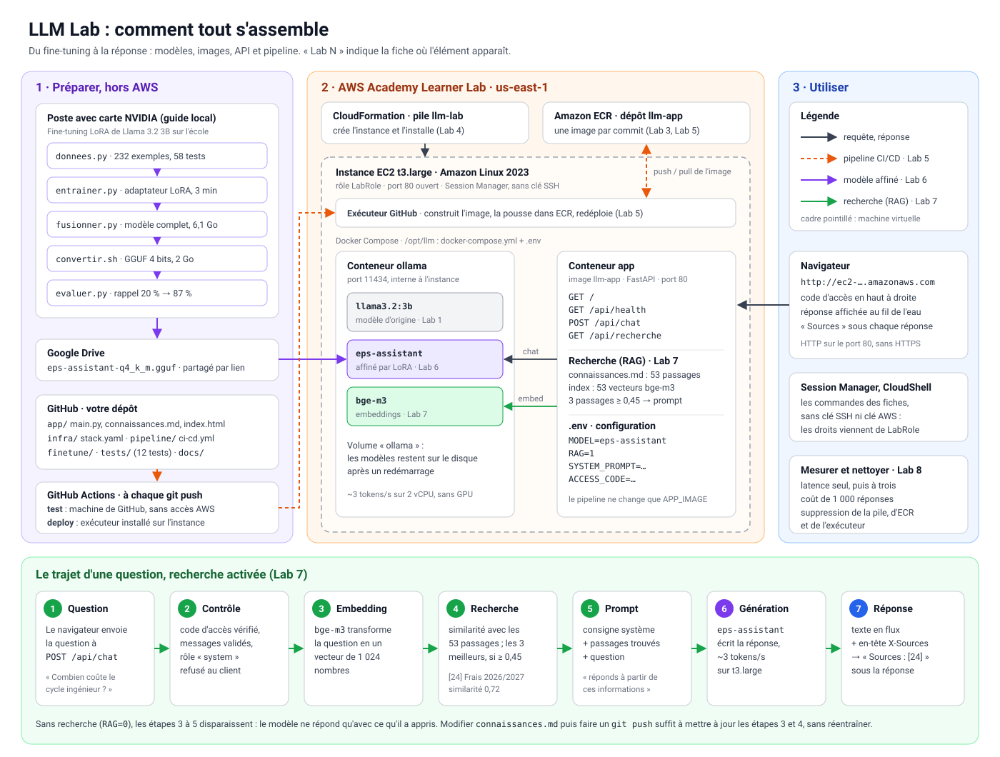

# Déployer un LLM de A à Z sur AWS Academy — formation pas à pas

## Les fiches

1. [Lab 0 — Démarrer le Learner Lab et préparer le dépôt](lab-0.md)
2. [Lab 1 — Servir un LLM à la main sur EC2](lab-1.md)
3. [Lab 2 — API et interface web](lab-2.md)
4. [Lab 3 — Image conteneur dans Amazon ECR](lab-3.md)
5. [Lab 4 — Tout recréer avec CloudFormation](lab-4.md)
6. [Lab 5 — Pipeline CI/CD](lab-5.md)
7. [Lab 6 — Spécialiser l'assistant pour Polytechnique Sousse](lab-6.md)
8. [Lab 7 — Ajouter une recherche documentaire (RAG)](lab-7.md)
9. [Lab 8 — Mesurer, superviser, nettoyer](lab-8.md)
10. [Guide de l'enseignant](guide-enseignant.md)

La formation existe aussi [en un seul fichier](../formation-aws-pas-a-pas.md), pour l'imprimer ou la lire hors ligne.

**Entraîner votre propre assistant** sur vos données, pour le Lab 6 : 

## Avant de commencer

### Ce que vous allez construire

En neuf labs, vous mettez en ligne un assistant de discussion sur AWS :

1. un modèle de langage ouvert, Llama 3.2 3B, qui tourne sur votre propre machine virtuelle ;
2. une API et une page web pour discuter avec lui depuis un navigateur ;
3. une infrastructure décrite dans un fichier, que vous pouvez détruire et recréer en une commande ;
4. un pipeline qui teste et déploie votre code à chaque `git push` ;
5. un assistant spécialisé sur l'École Polytechnique de Sousse, obtenu par fine-tuning ;
6. une recherche documentaire (RAG), qui fournit au modèle les documents de l'école à chaque question.

| Lab | Titre | Durée | Vous repartez avec |
| --- | --- | --- | --- |
| 0 | [Démarrer le Learner Lab et préparer le dépôt](lab-0.md) | 30 min | Console AWS ouverte, dépôt GitHub prêt |
| 1 | [Servir un LLM à la main sur EC2](lab-1.md) | 60 min | Un modèle qui répond à `curl` |
| 2 | [API et interface web](lab-2.md) | 60 min | Une page de discussion publique |
| 3 | [Image conteneur dans Amazon ECR](lab-3.md) | 45 min | Une image versionnée dans un registre privé |
| 4 | [Tout recréer avec CloudFormation](lab-4.md) | 60 min | Une pile qui reconstruit le service seule |
| 5 | [Pipeline CI/CD](lab-5.md) | 75 min | Un `git push` qui teste, construit et déploie |
| 6 | [Spécialiser l'assistant pour Polytechnique Sousse](lab-6.md) | 60 min | Un modèle affiné en service, et sa mesure avant/après |
| 7 | [Ajouter une recherche documentaire (RAG)](lab-7.md) | 60 min | Un assistant qui cite ses sources, et des connaissances modifiables sans réentraînement |
| 8 | [Mesurer, superviser, nettoyer](lab-8.md) | 45 min | Trois mesures et un compte propre |

Les labs se suivent dans l'ordre. Chacun se termine par un point de contrôle que l'enseignant vérifie.

### Comment lire ces fiches

- Chaque étape donne **l'action exacte**, puis ***le résultat attendu en italique***. Si vous n'obtenez pas ce résultat, arrêtez-vous et regardez le tableau « Si ça bloque » en fin de lab.
- Les libellés de la console sont en anglais, comme à l'écran.
- Les valeurs à remplacer sont en majuscules. `COMPTE` est votre nom de compte GitHub, `MON-CODE` un code d'accès que vous choisissez (6 caractères au moins, sans espace).
- Les durées et les sorties indiquées sont celles observées pendant le test. Les vôtres seront proches, pas identiques.

### À quoi vous attendre : le modèle est lent, et c'est normal

Le Learner Lab n'offre ni GPU ni machine de plus de 2 processeurs virtuels. Sur l'instance `t3.large` du lab, le modèle écrit environ **3 tokens par seconde**, soit à peu près deux mots par seconde. Une réponse d'une phrase prend 20 à 30 secondes, une réponse de dix lignes plus d'une minute. Ce n'est pas une panne : la réponse s'affiche au fil de l'eau, attendez-la.

Débits mesurés pendant le test, sur la même question :

| Instance | Tarif à la demande | Llama 3.2 3B | Llama 3.2 1B |
| --- | --- | --- | --- |
| `t3.large` (défaut) | 0,083 $ par heure | 2,5 à 3,2 tokens/s | 4,4 tokens/s |
| `m7i.large` | environ 0,10 $ par heure | 3,9 à 4,6 tokens/s | 8,9 tokens/s |

Les tarifs sont cités de mémoire : vérifiez-les sur la page de tarification AWS.

### Les règles du Learner Lab

| Règle | Conséquence dans les labs |
| --- | --- |
| Région `us-east-1` | Tout se fait en `us-east-1` (N. Virginia) |
| Instances de taille « large » au plus, pas de GPU | Instance `t3.large`, modèle sur processeur |
| IAM verrouillé : aucun utilisateur ni rôle à créer | On utilise le rôle fourni `LabRole` et son profil `LabInstanceProfile` |
| Identifiants temporaires, renouvelés à chaque session de 4 heures | Aucune clé AWS dans GitHub : le déploiement part d'un exécuteur installé sur l'instance |
| Instances arrêtées en fin de session, nouvelle adresse au redémarrage | L'adresse du site change à chaque session ; les conteneurs redémarrent seuls |
| Amazon Bedrock refusé (`AccessDenied`) | On déploie soi-même un modèle ouvert |

### Votre budget : 50 $

Le parcours complet devrait consommer moins de 10 $ (estimation). Trois réflexes :

1. À la fin de chaque séance, cliquez **End Lab** : vos instances sont arrêtées, vos ressources conservées.
2. Entre deux séances, seul le disque de l'instance est facturé (environ 2,40 $ par mois pour 30 Gio).
3. À la fin du Lab 8, supprimez tout.

Une `t3.large` laissée allumée en continu consommerait les 50 $ en 25 jours environ.
